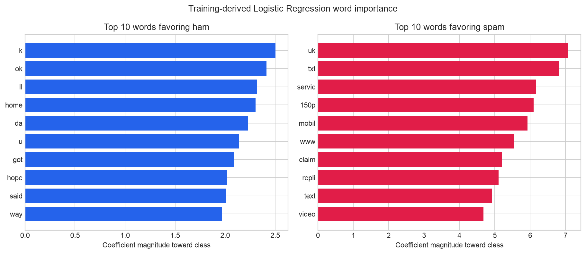
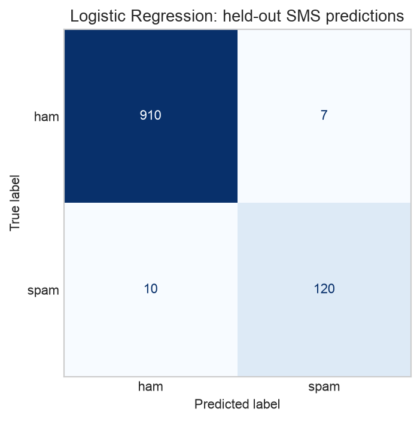

# Dev Week2: Classify Text Sentiment — SMS Text Classification

## Problem statement
Classify Text Sentiment — Preprocess the text (lowercase, remove punctuation/stopwords, tokenize, stem or lemmatize), extract features using Bag-of-Words or TF-IDF, then train a text classification model (e.g. Naive Bayes or Logistic Regression) to predict the label. Report Accuracy and F1-score, and show the top 10 most important words per class.

## Dataset and labels
[SMS Spam Collection Dataset on Kaggle](https://www.kaggle.com/datasets/uciml/sms-spam-collection-dataset).
The supplied labels are **ham** (legitimate messages) and **spam**, so the notebook
predicts ham/spam. Positive/negative sentiment labels are not present.
[Original source and citation: UCI](https://archive.ics.uci.edu/dataset/228/sms+spam+collection).
The source data is attached or downloaded from Kaggle rather than redistributed here.

## Submission links
- [Public Kaggle notebook](https://www.kaggle.com/code/bhanupriyacn/dev-week2-sms-text-classification-tfidf)
- [Executed GitHub notebook](https://github.com/Bhanupriyacn/dev-week2-sms-text-classification/blob/main/dev_week2_sms_text_classification.ipynb)
- Notebook for upload: `dev_week2_sms_text_classification.ipynb`

## Implementation
Lowercase → punctuation removal → tokenization → English stopword removal →
Porter stemming → TF-IDF → Logistic Regression. The model uses fixed `C=5`,
balanced class weights and `random_state=42`. TF-IDF is fitted on training data
only. Exact duplicates are removed; equivalent processed messages remain in one
partition using a deterministic stratified group holdout based on SHA-256. The
test data is not used for tuning.

## Held-out results
| Measure | Result |
|---|---:|
| Raw SMS messages | 5572 |
| Exact duplicates removed | 403 |
| Unique messages | 5169 |
| Training messages | 4122 |
| Test messages | 1047 |
| Accuracy | 0.9838 (98.38%) |
| F1 — spam | 0.9339 |
| F1 — ham | 0.9907 |
| F1 — macro | 0.9623 |
| F1 — weighted | 0.9837 |
| Spam precision | 0.9449 |
| Spam recall | 0.9231 |

Accuracy can hide minority-class failures; the notebook therefore compares
against a majority-class baseline and reports F1 for each class. The confusion
matrix includes false positives and false negatives. These results describe one
fixed holdout partition of this historical SMS dataset.

## Top 10 important words per class
These are training-derived Logistic Regression word stems, ranked by coefficient
magnitude in the direction of each class. They are associations, not causes.
Purely numeric features are excluded from this word list but remain model inputs.

- **Ham:** k, ok, ll, home, da, u, got, hope, said, way.
- **Spam:** uk, txt, servic, 150p, mobil, www, claim, repli, text, video.

## Files and reproduction
- `dev_week2_sms_text_classification.ipynb`: complete executed notebook, including the assignment statement.
- `classification_metrics.csv`, `per_class_report.csv`: accuracy and F1 metrics.
- `top_10_words_per_class.csv`: all 20 ranked words with coefficients.
- `split_summary.csv`, `test_predictions.csv`, `results_summary.json`: split and evaluation evidence.
- `requirements.txt`: Python dependencies.

Install `requirements.txt` and run every notebook cell. On Kaggle, attach the
linked dataset; standard dependencies are preinstalled and no NLTK corpora are
downloaded. Locally the loader accepts `data/sms_spam/spam.csv`, or can download
the public source archive when internet is available. Outputs on Kaggle are
written to `/kaggle/working/dev_week2_sms_outputs`. Python/library versions are
printed in the notebook; Python 3.10+ is recommended.
